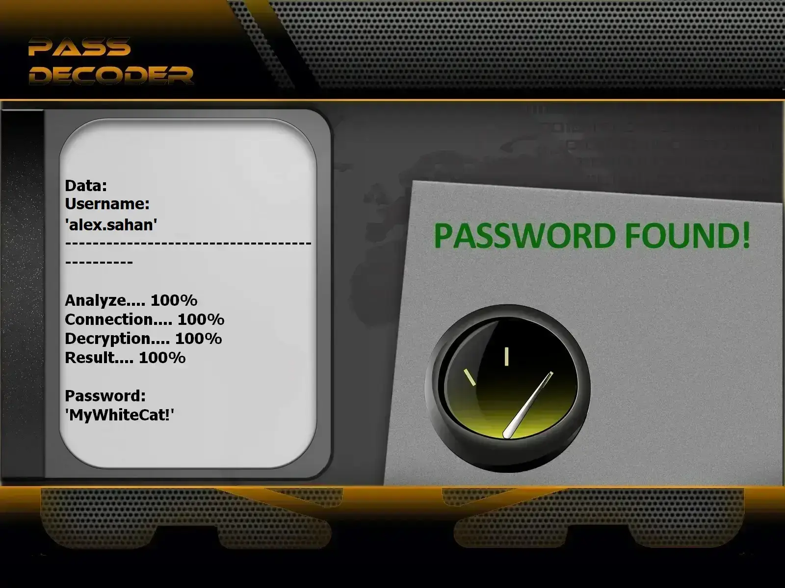

# 🔐 Pirater un Compte Snapchat 2026 — Outil Hacker & Cracker Éthique | Usage Éducatif

**Auditeur de credentials Snapchat propulsé par l'IA — formation, recherche et comptes autorisés uniquement.**


> **Mots-clés :** pirater Snapchat, hacker compte Snap, cracker mot de passe Snapchat, piratage Snap, hacking éthique, audit sécurité Snapchat, cybersécurité 2026

---

## ⚠️ AVIS JURIDIQUE — LECTURE OBLIGATOIRE

**Ce dépôt GitHub est limité à la FORMATION, la RECHERCHE et les TESTS DE SÉCURITÉ AUTORISÉS.**

Tenter de **pirater**, **cracker** ou **hacker** un profil Snapchat sans consentement explicite constitue une **infraction pénale**. En utilisant ce logiciel, vous acceptez un cadre d'usage strictement légal.

**Conçu avec l'API PASS REVELATOR.** Pour approfondir la sécurisation des comptes Snap et les risques de **piratage de mots de passe**, consultez :  
**[https://www.passwordrevelator.net/fr/passdecoder](https://www.passwordrevelator.net/fr/passdecoder)**



- 🚫 **Usage interdit** : Tester un compte dont vous n'êtes pas propriétaire est illégal
- ✅ **Autorisation requise** : Ciblez uniquement vos comptes ou des environnements couverts par un audit signé
- 🔐 **Sensibilisation** : Mettre en lumière les mots de passe faibles et promouvoir l'authentification forte
- ⚖️ **Responsabilité** : Vous êtes seul responsable du respect des lois locales et internationales

---

## 🧭 De quoi s'agit-il ?

**L'Évaluateur de Sécurité Snapchat** est un framework Python de laboratoire. Il montre comment un **cracker** exploite des identifiants prévisibles sur la plateforme Snap — et comment un **hacker éthique** en tire des recommandations de durcissement.

Aucun module ne vise l'exploitation de profils tiers : simulation, rapport et apprentissage sur infrastructure que vous contrôlez.

---

## 🎓 Compétences développées

| Objectif | Résultat attendu |
| -------- | ---------------- |
| Comprendre le **piratage de comptes** | Rejouer dictionnaire, masque, hybride et brute force en labo |
| Mesurer sa robustesse | Benchmarker un compte Snap de test personnel |
| Renforcer les défenses | Adopter des mots de passe uniques et activer la 2FA |
| Analyser l'API Snap | Explorer le flux d'authentification et ses garde-fous |
| Recherche IA | Expérimenter le scoring intelligent de candidats |

---

## ✨ Modules intégrés

### 🔑 Modes d'analyse

| Mode | Description |
| ---- | ----------- |
| **Passe dictionnaire** | Confronte le mot de passe à des wordlists publiques ou custom |
| **Génération par masque** | Produit des combinaisons via schémas (`?l`, `?u`, `?d`, `?s`) |
| **Mutations par règles** | Transforme des mots de base (`snap2024` → `Sn@p2024!`) |
| **Pipeline hybride** | Enchaîne plusieurs stratégies pour élargir la couverture |

### 🌐 Couche opérationnelle

- Rotation automatique de proxys
- Routage optionnel via le réseau **Tor**
- Throttling adaptatif des requêtes
- Randomisation des en-têtes User-Agent

### 📊 Suivi & rapports

- Statistiques live (tentatives, succès, débit)
- Monitoring CPU/RAM via `psutil`
- Journaux exportables pour debrief pédagogique

### 🔒 Gestion des sessions

- Traitement des jetons CSRF
- Requêtes compatibles API Snapchat
- Cycle de vie sécurisé des sessions
- Détection CAPTCHA avec arrêt propre

---

## 🚀 Installation

### Prérequis

- Python **3.8+**
- Gestionnaire `pip`
- Connexion Internet stable
- Compte Snapchat **de test dont vous êtes titulaire**

### Étape 1 — Cloner le dépôt

```bash
git clone https://github.com/HoffmannAlex/Pirater-un-compte-Snapchat-Avec-IA.git
cd snapchat-password-tool
```

### Étape 2 — Installer les dépendances

```bash
pip install -r requirements.txt
```

**Bibliothèques principales :**

- `aiohttp>=3.8.0`
- `requests>=2.28.0`
- `cryptography>=3.4.0`
- `stem>=1.8.0`
- `psutil>=5.9.0`

### Étape 3 — Vérifier l'installation

```bash
python hack_snapchat.py --help
```

---

## ⚡ Démarrage rapide (comptes autorisés uniquement)

**Audit wordlist standard**

```bash
python hack_snapchat.py --username your_test_account --password-list passwords.txt
```

**Session labo via Tor**

```bash
python hack_snapchat.py --username your_test_account --password-list passwords.txt --use-tor
```

**Exécution multi-threads avec jitter**

```bash
python hack_snapchat.py --username your_test_account --password-list passwords.txt --threads 4 --use-tor --min-delay 2 --max-delay 5
```

**Rotation de proxys**

```bash
python hack_snapchat.py --username your_test_account --password-list passwords.txt --proxy-list proxies.txt --threads 3
```

> ⚠️ Remplacez `your_test_account` par un profil **que vous possédez**.

---

## 🔥 Stratégies de cracking supportées

### 1. Audit par dictionnaire

```bash
python hack_snapchat.py --username target --password-list common_passwords.txt
python hack_snapchat.py --username target --password-list custom_list.txt
```

### 2. Attaque par masque

```
?l?l?l?d?d?d   # ex. abc123
?u?l?l?l?d?d   # ex. Abcd12
?l?l?l?l?s?d   # ex. abcd!1
```

### 3. Combinaisons intelligentes

```bash
python hack_snapchat.py --username target --strategy combination --base-words "password,snap,user"
```

### 4. Simulation force brute (pédagogique)

```bash
python hack_snapchat.py --username target --strategy brute --min-length 4 --max-length 8
```

> La force brute sur des plateformes live est lente et illégale sans autorisation. Réservez ce mode aux environnements isolés.

---

## ❓ FAQ — Pirater, hacker ou cracker Snapchat ?

**Hacker ou cracker — quelle différence ?**  
Le **hacker** étudie les systèmes pour les sécuriser. Le **cracker** vise l'intrusion sans mandat. Ce dépôt s'adresse au premier profil.

**Puis-je légalement pirater mon propre Snap ?**  
Oui — sur un compte que vous avez créé ou en labo avec accord écrit. **Pirater** le profil d'un tiers est un délit.

**Pourquoi un cracker parvient-il parfois à pirater un compte ?**  
Mots de passe faibles, réutilisation, absence de 2FA, phishing — vecteurs illustrables sur **vos** comptes uniquement.

**Cet outil piratera-t-il n'importe quel Snapchat ?**  
Non. Identifiants robustes, alertes de connexion et double authentification bloquent la plupart des attaques classiques. L'objectif est la **prévention**.

---

## ⚖️ Usage responsable

- Portée strictement **éducative**
- **Autorisation écrite** obligatoire avant tout audit
- Respect des **limites de débit** et des Conditions d'utilisation Snapchat
- Activez la **double authentification (2FA)**
- Utilisez un **gestionnaire de mots de passe**

---

## 📜 Licence

Distribué pour **usage éducatif uniquement**. Consultez le fichier `LICENSE`. Accès non autorisé, revente ou redistribution malveillante interdits.

> ⭐ Ajoutez une étoile au dépôt si ce framework vous a aidé !
