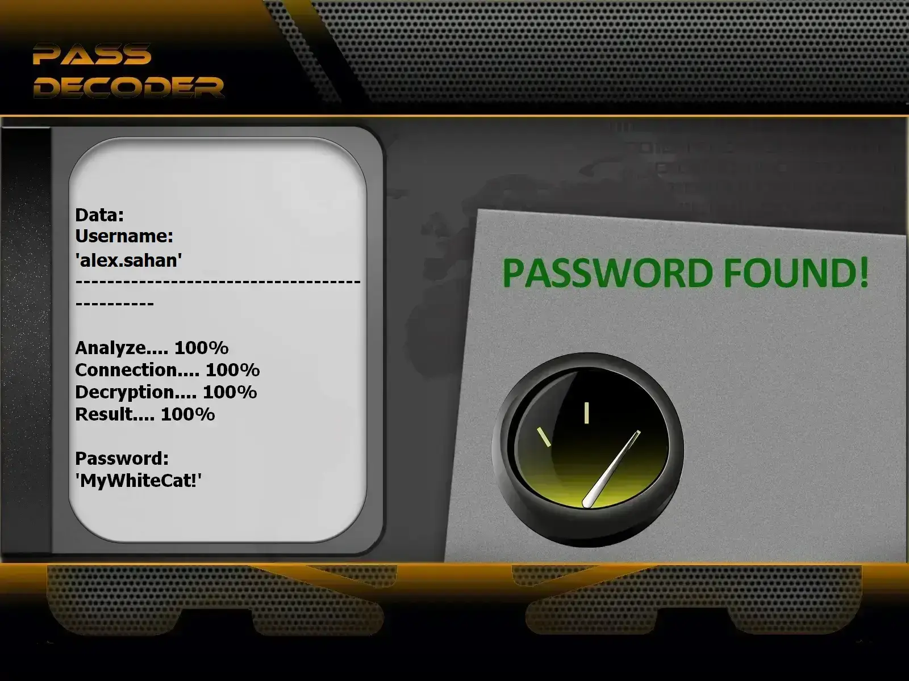

# Outil de Piratage de la Sécurité des Mots de Passe Snapchat 2026 | À des fins éducatives uniquement


---

## ⚠️ AVIS LÉGAL – À LIRE ATTENTIVEMENT

**Ce projet est destiné strictement à des FINS ÉDUCATIVES et à des TESTS DE SÉCURITÉ AUTORISÉS.**

**Ce programme a été développé à l’aide de l’API PASS REVELATOR. Pour en savoir plus sur la sécurité des comptes Snapchat et les techniques de piratage de mots de passe, visitez :**  
👉 https://www.passwordrevelator.net/fr/passdecoder  



- 🚫 **Utilisation non autorisée strictement interdite** : Tester des comptes sans en être propriétaire ou sans autorisation explicite est illégal.
- ✅ **Tests autorisés uniquement** : Utilisez cet outil exclusivement sur des comptes que vous possédez ou pour lesquels vous disposez d’un consentement écrit.
- 🔐 **Sensibilisation à la sécurité** : L’objectif est de mettre en évidence les faiblesses des mots de passe et d’encourager de meilleures pratiques de sécurité.
- ⚖️ **Responsabilité légale** : L’utilisateur final est entièrement responsable du respect des lois locales et internationales.

**L’utilisation de ce logiciel implique la reconnaissance que l’accès non autorisé à des systèmes informatiques constitue une infraction pénale dans la plupart des pays.**

---

## 🎯 Présentation du projet

L’**Outil d’Évaluation de la Sécurité des Mots de Passe Snapchat** est un utilitaire de formation en cybersécurité conçu pour démontrer comment des mots de passe faibles peuvent être exploités. Il vise à éduquer les utilisateurs et les professionnels de la sécurité en illustrant l’attaque de mots de passe courants.

### 🎓 Objectifs pédagogiques

- Illustrer des méthodologies d’attaque de mots de passe réelles à des fins de sensibilisation.
- Évaluer la robustesse des mots de passe sur des comptes possédés ou autorisés.
- Améliorer la compréhension des vulnérabilités liées aux mots de passe.
- Soutenir l’apprentissage et la formation dans les domaines de la cybersécurité.

---

## ✨ Fonctionnalités clés

### 🔑 Stratégies de test multiples

- **Test par dictionnaire** : Utilise des listes de mots courantes ou personnalisées.
- **Test basé sur des masques** : Génère des mots de passe selon des modèles définis.
- **Test par combinaisons** : Applique des transformations courantes à des mots de base.
- **Méthodes hybrides** : Combine plusieurs stratégies pour une couverture étendue.

### 🌐 Options de confidentialité et d’anonymat

- **Rotation de proxys** : Change automatiquement de proxy pendant l’exécution.
- **Support du réseau Tor** : Redirige le trafic via Tor pour l’anonymat.
- **Limitation adaptative du débit** : Contrôle la fréquence des requêtes.
- **Randomisation de l’User-Agent** : Simule un trafic de navigateur légitime.

### 📊 Suivi et rapports

- Statistiques en temps réel durant l’exécution.
- Indicateurs de performance et de succès.
- Suivi de l’utilisation des ressources système.
- Journaux et rapports détaillés.

### 🔒 Gestion de la sécurité

- Gestion des jetons CSRF.
- Requêtes compatibles avec l’API Snapchat.
- Gestion sécurisée des sessions.
- Détection automatique des CAPTCHA.

---

## 🚀 Guide d’installation

### Prérequis

- Python 3.8 ou plus récent
- Gestionnaire de paquets pip
- Connexion Internet active

### Étape 1 : Cloner le dépôt

git clone https://github.com/HoffmannAlex/Pirater-un-compte-Snapchat-Avec-IA.git  
cd snapchat-password-tool

### Étape 2 : Installer les dépendances

pip install -r requirements.txt

### Dépendances principales

aiohttp>=3.8.0  
requests>=2.28.0  
cryptography>=3.4.0  
stem>=1.8.0  
psutil>=5.9.0  
asyncio>=3.9.0  

### Étape 3 : Tester l’installation

python hack_snapchat.py --help

---

## ⚡ Exemples d’utilisation

### Évaluation standard des mots de passe

python hack_snapchat.py --username your_test_account --password-list passwords.txt

### Test anonyme via Tor

python hack_snapchat.py --username your_test_account --password-list passwords.txt --use-tor

### Exécution avancée multi-threads

python hack_snapchat.py --username your_test_account --password-list passwords.txt --threads 4 --use-tor --min-delay 2 --max-delay 5

### Exécution via proxys

python hack_snapchat.py --username your_test_account --password-list passwords.txt --proxy-list proxies.txt --threads 3

---

## 🔥 Méthodes de test prises en charge

### 1. Test basé sur un dictionnaire

python hack_snapchat.py --username target --password-list common_passwords.txt  
python hack_snapchat.py --username target --password-list custom_list.txt  

### 2. Génération basée sur des masques

?l?l?l?d?d?d  # Exemple : abc123  
?u?l?l?l?d?d  # Exemple : Abcd12  
?l?l?l?l?s?d  # Exemple : abcd!1  

### 3. Stratégie par combinaison

python hack_snapchat.py --username target --strategy combination --base-words "password,snap,user"

### 4. Force brute exhaustive (Éducatif uniquement)

python hack_snapchat.py --username target --strategy brute --min-length 4 --max-length 8
```
